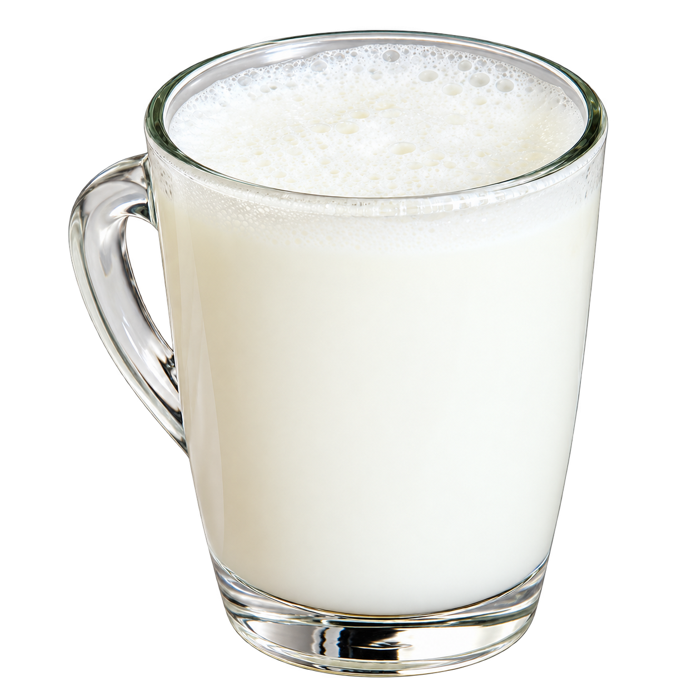
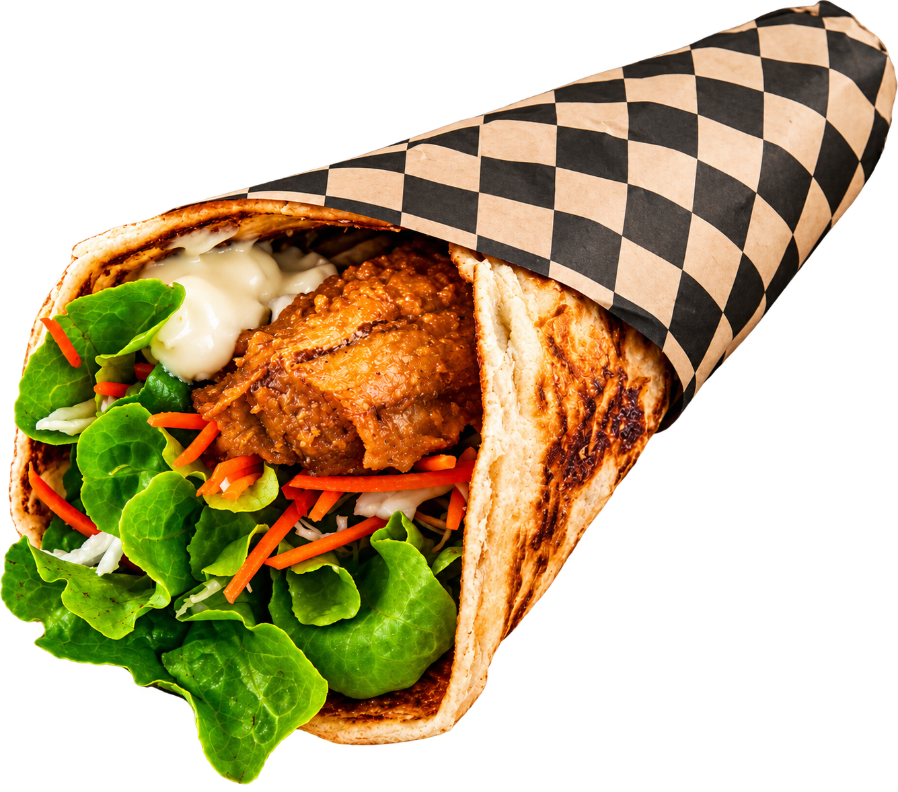
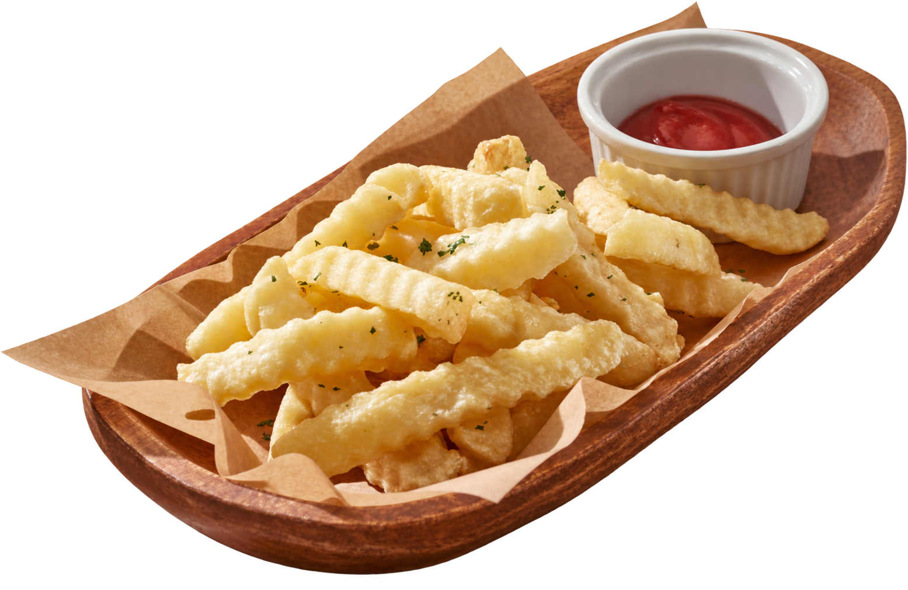
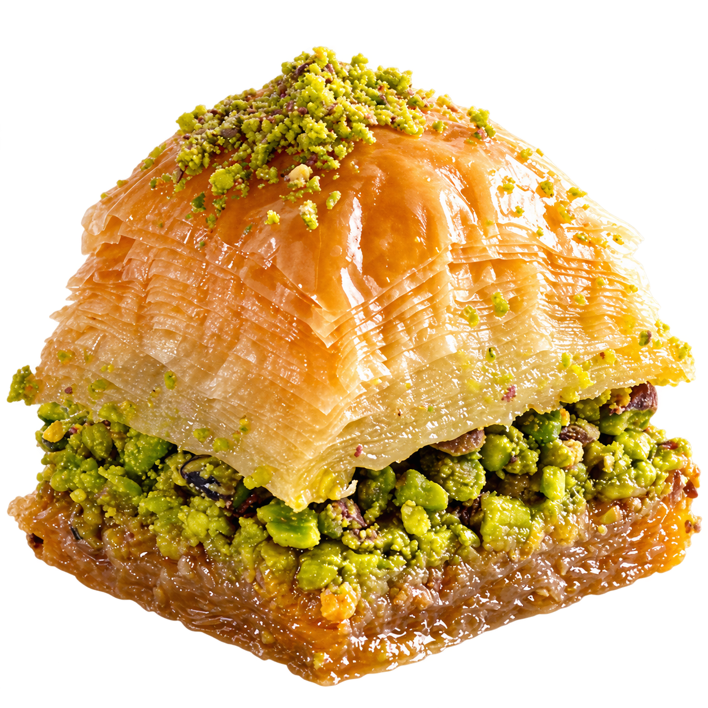
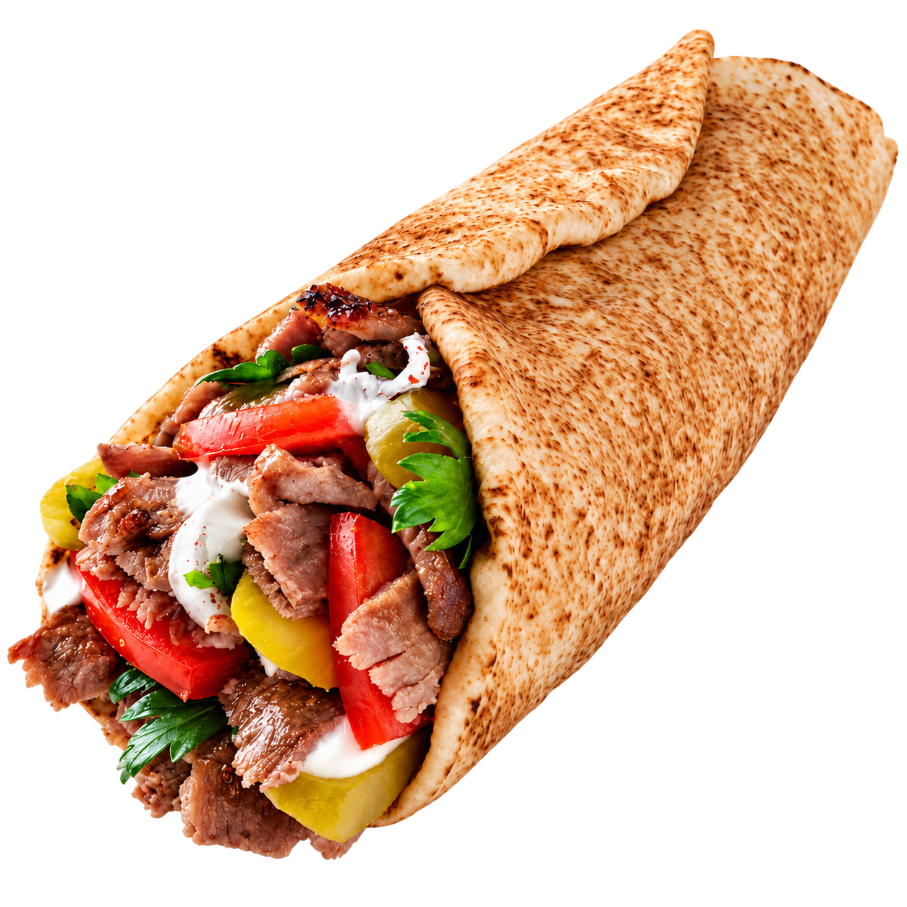

# Image sources

Some product photos were improved with AI. The exact files and AI tool are unknown.

| Preview | Image files | Source and credit |
| --- | --- | --- |
|  | `src/assets/products/ayran.png` `public/products/ayran.png` | [Canva: Traditional Turkish Lahmacun with Salad and Ayran](https://www.canva.com/photos/MAGqX9EGBms-traditional-turkish-lahmacun-with-salad-and-ayran/) Pexels source, Cihan Çimen |
|  | `src/assets/products/doner-wrap2.png` `public/products/doner-wrap2.png` `src/assets/promotions/promotion.png` `public/promotions/promotion.png` | [Canva: Shawarma Wrapped on Checkered Wax Paper](https://www.canva.com/photos/MAEtht6AT0o-shawarma-wrapped-on-checkered-wax-paper/) Pexels source, Karen Laårk Boshoff |
|  | `src/assets/products/fries.png` `public/products/fries.png` `src/assets/promotions/promotion2.png` `public/promotions/promotion2.png` | [Canva: Golden Crinkle Cut French Fries with Ketchup](https://www.canva.com/photos/MAGcthNOnQo-golden-crinkle-cut-french-fries-with-ketchup/) Aflo Images source |
|  | `src/assets/products/baklava.png` `public/products/baklava.png` | [Unsplash photo](https://unsplash.com/photos/brown-bread-with-green-vegetable-on-white-ceramic-plate-Z8nrygSBcLE) Ömer Haktan Bulut |
|  | `src/assets/products/doner-wrap.png` `public/products/doner-wrap.png` | [Unsplash photo](https://unsplash.com/photos/a-pita-sandwich-on-a-plate-with-a-small-bowl-of-ranch-dressing-e8F2zJzJxkI) Orkun Orcan |
|  | `src/assets/logo/donerhere_logo.png` | Created by Baran Ahmedov |
